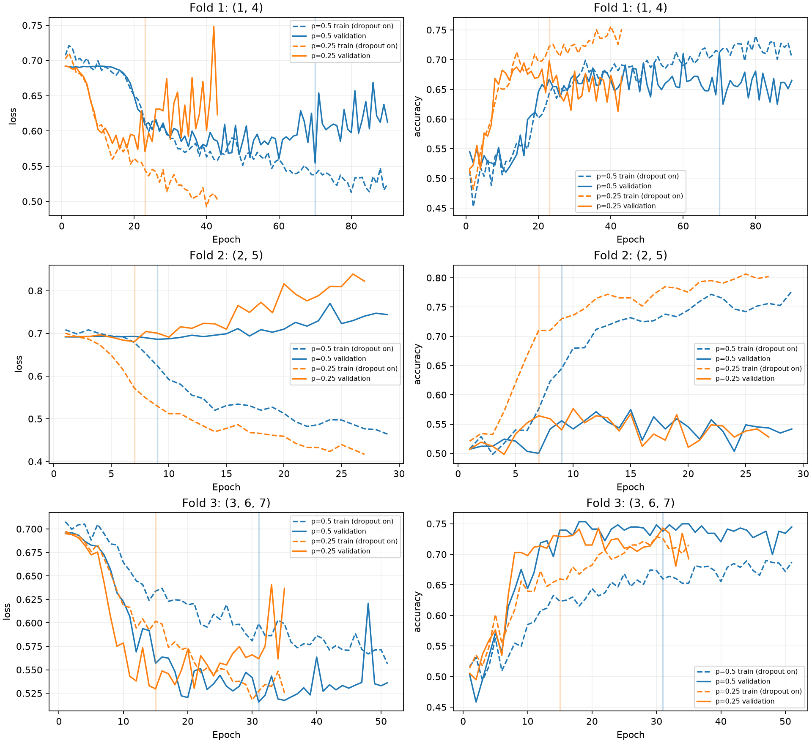

# Controlled TinyEEGNet regularization-dropout comparison

Seed 42; unchanged 1,938-parameter architecture and preprocessing. All six fits started from scratch. The baseline files are unchanged.

Held-out development folds: {1,4}, {2,5}, {3,6,7}. Each contains 576 validation trials and 1,152 training trials. Only S1–5 both sessions and S6–7 session 1 were used for CV. S6–7 session 2 and S9 were not loaded or evaluated. Subject 8 did not select dropout.

| Held-out participant | Dropout 0.5 BA | Dropout 0.25 BA | Change (points) |
|---|---:|---:|---:|
| 1 | 77.78% | 72.92% | -4.86 |
| 2 | 57.29% | 56.60% | -0.69 |
| 3 | 90.62% | 88.89% | -1.74 |
| 4 | 64.58% | 66.67% | +2.08 |
| 5 | 53.82% | 56.25% | +2.43 |
| 6 | 63.19% | 62.50% | -0.69 |
| 7 | 50.69% | 51.39% | +0.69 |

All participant validation sets are class-balanced, so their accuracy equals balanced accuracy.
The selection mean gives each of the seven participants equal weight; it is not the mean of three folds.

| Summary across participants | Dropout 0.5 | Dropout 0.25 |
|---|---:|---:|
| Mean BA | 65.43% | 65.03% |
| Population standard deviation | 13.15% | 11.80% |
| Range | 50.69%–90.62% | 51.39%–88.89% |

| Fold | Dropout | Train accuracy | Train BA | Validation accuracy | Validation participant mean BA | Best / stopped epoch | Training minutes |
|---|---:|---:|---:|---:|---:|---|---:|
| 1 | 0.5 | 74.31% | 74.31% | 71.18% | 71.18% | 70 / 90 | 11.56 |
| 1 | 0.25 | 70.92% | 70.92% | 69.79% | 69.79% | 23 / 43 | 6.65 |
| 2 | 0.5 | 73.52% | 73.52% | 55.56% | 55.56% | 9 / 29 | 4.44 |
| 2 | 0.25 | 75.09% | 75.09% | 56.42% | 56.42% | 7 / 27 | 4.18 |
| 3 | 0.5 | 69.01% | 69.01% | 73.78% | 68.17% | 31 / 51 | 7.49 |
| 3 | 0.25 | 70.83% | 70.83% | 72.92% | 67.59% | 15 / 35 | 5.64 |

Training summary metrics above use the selected checkpoint in evaluation mode. Learning curves retain the original dropout-on training measurements; their training/validation gap is not directly comparable across modes. Fits ran in pairs on CPU, four threads each; durations are wall times including contention.



## Predeclared selection rule

Advance dropout 0.25 only with mean gain ≥2 percentage points, gains for ≥4/7 participants and ≥2/3 fold means, and no participant decline >5 percentage points. This practical rule was saved before training; it is not a statistical significance test.

Observed mean gain: -0.40 points. Participants improved: 3/7. Fold gains (points): [-1.39, 0.87, -0.58]. Checks: {'mean_gain': False, 'participants_improved': False, 'folds_improved': False, 'maximum_decline': True}.

Dropout 0.25 did not pass. Retain the original model at `artifacts/combined-seed42-20261016/`; no final refit was performed and S8 was not loaded for this experiment.

## Verification and limitations

17 offline tests passed. Fold participants and normalization fitting were isolated; paired models had identical initial-state hashes and shared normalized inputs/shuffle seeds. All six checkpoint reloads and float torch.export checks passed. Original artifact/result SHA256 preservation check: True.
One seed was used as requested. Fold validation data also selected checkpoint epochs, so these are development/model-selection results, not a fresh unbiased test. No new performance claim is made for the previously inspected demonstration or S9 sets. No quantization, hardware deployment, structural ablation, or sensor-dropout experiment was performed.

## Outputs

`completed_runs.json` contains training/validation metrics, participant confusion matrices, best epochs and durations. `selection.json` contains the participant-level comparison and selection decision. `protocol.json` records the predeclared protocol and baseline hashes. `verification.json` records preservation and model checks. The separate ignored artifact directory contains each fold’s normalization, split manifest, inputs, paired configurations, checkpoints, float exports and full training histories.

Commands:
```bash
.venv/bin/python -m unittest discover -s tests -v
.venv/bin/python -m src.experiments.dropout_cv
```
